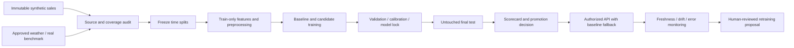

# RetailOps AIML methodology and report chapter

Status: M14 design specification, 23 October 2026. This chapter describes the proposed extension unless explicitly marked as existing. No trained ML model, live source, or new accuracy result is claimed. Audited code base: `c27fef0a0c5cf7c84551a5940ef3ced8e9f00b93`.

## Problem and research questions

Predict observed units sold per day to support retail planning. Sales are a proxy for demand: without stock availability, unconstrained demand and lost sales cannot be identified. Compare simple, statistical and machine-learning methods under the same information and evaluation budget. Determine whether weather improves predictions, where a method fails, and whether uncertainty estimates cover observations at their stated rate. Retain deterministic responses whenever evidence, history, dependencies or connectivity are insufficient.

Targets: daily units at chain, store, store/category and store/SKU levels, with 1-, 7-, 14- and 28-day output windows. Store/category is the proposed pooled ML level, subject to coverage checks; chain-level data is the first feasible baseline experiment. Delivery-risk, routing, retrieval, similarity and anomaly evaluation are separate tasks with their own labels and metrics. Forecasts and recommendations support human decisions, not automated purchases, pricing or employment actions.

## Verified existing implementation

- `app/conversation/forecast.py`: naive, moving-average-7, exponential-0.3, seasonal-naive-7 and weekday-mean-28 candidates subject to history thresholds; seasonal-naive-365 is enabled only at 730 training days. Last up to 28 one-step folds are ranked by MAE, then RMSE. Selection and reporting reuse the folds, so these scores are not independent test accuracy.
- `app/enterprise/retail.py::forecast` uses SQL daily sums and these shared functions; it requires 14 contiguous observed dates through the requested origin. It returns point forecasts, not calibrated intervals.
- `app/conversation/forecast.py::forecast` additionally requires stable store/SKU coverage; its residual bands are heuristic. Do not confuse this stricter path with the enterprise aggregate path.
- `app/agents/forecasting/domain.py` offers two methods (moving average and exponential), a Bayesian protocol but no fitted posterior, and heuristic bands.
- `app/orchestration/router/contracts.py` defaults to a 0.65 routing threshold. The PDF's general 0.85 description is not accepted as a verified universal router setting. Audit optional classifier paths separately in M18.
- Signed RAG, role/store scoping and chained audit already exist. No `app/ml/` or `app/realtime/` implementation is introduced in M14.

## CRISP-DM lifecycle and evidence

| Stage | Required activity | Evidence / implementation milestone |
|---|---|---|
| Problem framing | Define targets, horizons, decisions and limits | This chapter (M14) |
| Data understanding | Source hashes, coverage, missingness, leakage and outliers | DATA_CARD.md and DATA_AUDIT.json (M14); train-only distribution audit M15 |
| Preparation | Authorized SQL extraction, immutable inputs, explicit coverage masks | app/ml/features.py (M15) |
| Features | Time-safe calendar, lags, known covariates | FEATURES.md (M14), implementation M15 |
| Models | Existing baselines first, then required model families | M15 parity; M17 candidates |
| Validation | Frozen time splits, expanding windows, embargo | app/ml/evaluation.py (M15) |
| Evaluation | Error, uncertainty, significance and segments | M17/M18 scorecards |
| Deployment | Trusted artifact registry; baseline fallback and scope checks | M15 framework; M20 approved integration |
| Monitoring | Freshness, missingness, drift, errors and retraining proposal | M16/M20; no automatic promotion |
| Reproduction | Seed 42, pinned versions, config/data hash, per-trial JSONL | scripts/ml_run.py and ml_report.py (M15) |

## Data preparation and eligibility

Use source hashes in DATA_AUDIT.json. Keep all source money as Decimal or integer paise; convert only explicitly selected model inputs to numerical arrays. Sum transaction quantities, retain source and synthetic labels, and never join employee personal data into sales features. Use Asia/Kolkata for local event timestamps.

Build a calendar coverage mask before reindexing. An absent transaction on a date is unknown, not observed zero. The importer accepts positive quantities only; a missing store/SKU/day does not establish zero demand or a closed store. Do not fill gaps with zero, interpolate evaluation labels, or infer stock availability. A complete chain total does not prove every constituent store was observed.

Default eligible series: at least 56 contiguous observed training days for a weekly baseline, complete labels for every scored window and required feature history. Compare candidates on identical eligible origins and labels; publish exclusions and retained coverage. Models requiring more history must declare it before tuning. Sparse-demand algorithms may be implemented and tested on explicitly labelled fixtures, but workbook sparse-series effectiveness remains UNVERIFIED until true zero/exposure information exists. Missing data is not a reason to invent benchmark results.

## Frozen validation protocol

Proposed date partitions, locked before fitting:

| Partition | Inclusive dates | Use |
|---|---|---|
| Initial training | 2025-09-29 to 2026-03-31 | Initial fitting and feature design |
| Validation | 2026-04-01 to 2026-08-04 | Rolling tuning, calibration and model selection |
| Final test | 2026-08-05 to 2026-09-29 | Last 56 days; scored only after configuration/model lock |

Use expanding training windows with at least four validation cutoffs: 2026-03-31, 2026-04-21, 2026-05-12, 2026-06-09. For each horizon h, train through cutoff c, embargo c+1 through c+h, and score c+h+1 through c+2h. All these windows remain in validation. Fit scalers, encoders, imputers and feature selection on training rows only. Hyperparameter search is capped at 30 trials per model. Keep the actual cutoff/target dates in every result.

**Gap interpretation:** the PDF requires an h-day gap before the first scored day. Therefore these tests assess lead days h+1 to 2h, not ordinary next-day through day-h performance. Label them embargoed evaluations. Do not call a 28-day embargo result a tomorrow forecast. A separate operational evaluation without this embargo would require an explicitly approved protocol amendment and must not be mixed into the primary leaderboard.

Use the first three validation cutoffs for candidate selection and reserve the fourth for conformal calibration; never calibrate on the final test. At final freeze, use cutoff `2026-08-04 - h days`, leaving h embargo days before 5 August, and score the first h test dates. A second predeclared block begins 2 September; its training cutoff is also frozen before 5 August, so lead times are longer and reported explicitly. Do not refit on first-block test labels, select a new winner from test results, or silently average different lead times. Publish h=28 first block as the principal long-horizon result and both blocks separately; wider rolling test replay is future work requiring a predeclared protocol.

The full-year metadata audit in M14 inspects dates, counts and coverage but fits no models and evaluates no candidate predictions. Preserve the final labels from tuning code in M15. Test results are opened once after storing configuration and artifact hashes. A failed final check is reported; subsequent tuning requires a newly designated evaluation dataset rather than repeated reuse of this test.

## Metrics and decision rules

Point errors: MAE, RMSE, WAPE (null when actual total is zero), signed bias (prediction minus actual), and MASE scaled by training-only seven-day seasonal-naive absolute error (null if scale is zero or unavailable). Report macro series averages and volume-weighted totals separately; record scoring counts and exclusions.

Uncertainty: pinball loss at 0.1/0.5/0.9 quantiles, empirical 80% and 95% coverage and interval width. Default method is split conformal calibrated on rolling out-of-sample validation residuals; compare quantile boosting. Quantiles cannot use final-test errors. Heuristic historical bands remain explicitly labelled fallback only.

Compare paired daily errors with a moving-block bootstrap (seven-day blocks, fixed seed, 2,000 resamples, 95% interval) preserving temporal dependence and shared dates. Significance requires the error-difference interval to exclude zero in the candidate's favour. Small samples are marked inconclusive. Segment results by store, category and channel where comparable samples exist; do not invent channel breakdowns for a model that only predicts chain totals.

Choose the simplest candidate within 2% relative validation WAPE of the best. Predeclare simplicity order: existing baselines, linear, statistical, tree/boosting, ensemble, deep model. If WAPE is undefined, report inability to apply this rule. Preserve baseline artifacts regardless of their ranking. A trained candidate is promoted only if MASE beats seasonal-naive on the same scored rows, validation improvement over the best baseline is significant, and final-test WAPE is no worse. The locked baseline is served if this gate fails. Never promote a different candidate merely because it happened to win on the final test.

## Related tasks, reproducibility and safeguards

M18 requires 200+ human-reviewed router queries with ambiguity and all ten intents; split by paraphrase/template groups to prevent near-duplicate leakage. Retrieval needs 50+ positive and 15+ negative queries with evidence labels. Report router accuracy, macro-F1, confusion matrix and calibration; retrieval Recall@k, MRR, nDCG and abstention precision. Human review is a real gate, not a status the agent can self-certify.

Use a chronological order-level split for delivery prediction, excluding outcome fields and unresolved labels. Evaluate ROC-AUC, PR-AUC and calibration. Report price effects as correlational with uncertainty; product clustering uses train-only preparation, silhouette and ranking agreement. Inject anomalies only into held-out copies and retain clean originals. Reorder risk remains a labelled simulated proxy without stock/lead-time evidence.

Each future run records config, source hashes, code SHA, seed, Python/library versions, eligible rows, fold dates, trials, metrics and timing. Proposed commands `python -m scripts.ml_run --config configs/ml_baseline.yaml` and `python -m scripts.ml_report` are M15 deliverables and do not exist yet. Default runtime remains terminal-token login. External feeds and heavyweight downloads require separate approval. No outbound retail or employee data; weather requests may contain coordinates only. Offline and missing-library fallbacks must retain role/store checks and audit.

## Results and threats to validity

M14 has produced coverage evidence, not ML accuracy. Synthetic-workbook metrics cannot establish real-world performance. Only about one year of history exists (366 inclusive dates), insufficient for learned yearly seasonality. Festival dates require verified provenance. Historical reanalysis is not an archived forecast and must not be treated as weather known at a historical prediction origin. Price, discount and competitor snapshots lack reliable availability timestamps. Sparse records conceal true zeros and closures; stock constraints are unknown. Calibrated intervals and independent test accuracy are not implemented yet. A real benchmark's licence, representativeness and mapping must be reviewed separately.
